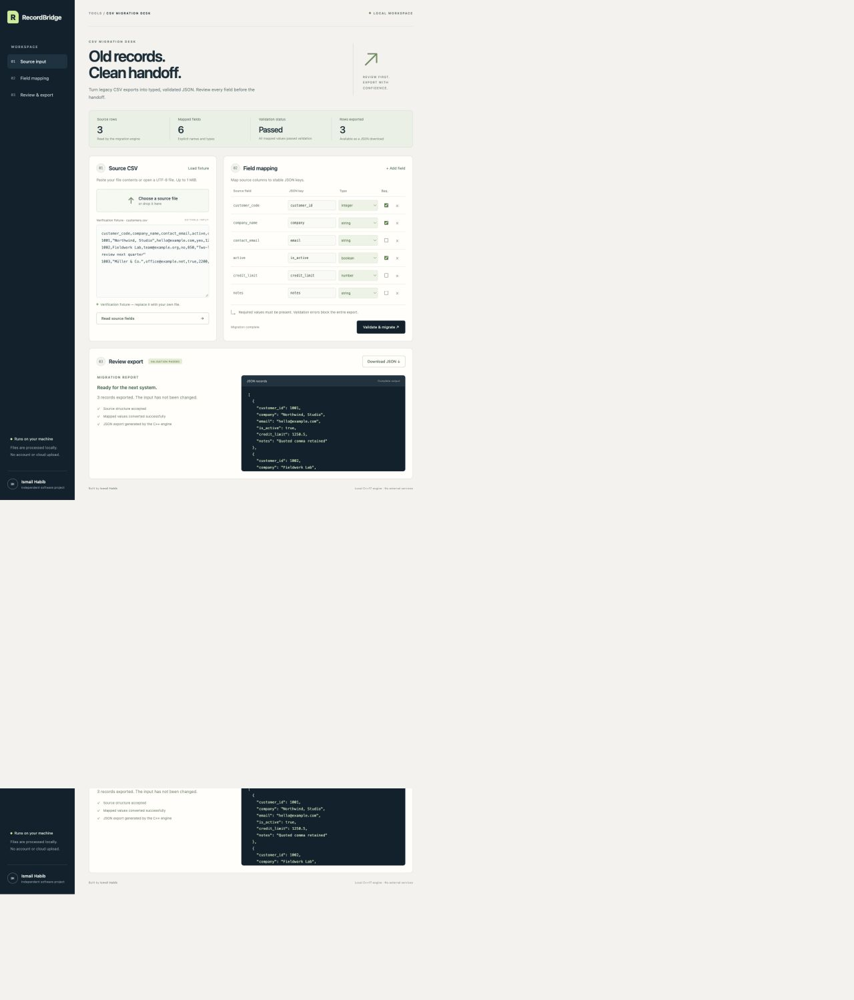
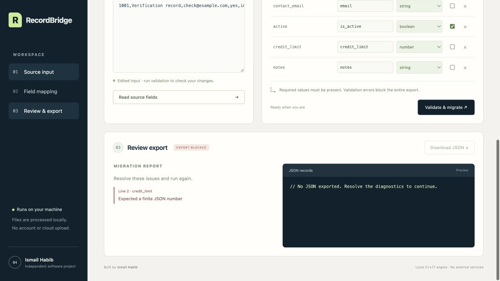

# RecordBridge — validated CSV-to-JSON migration

Convert CSV exports into typed JSON through explicit field mappings and validation. A C++17 engine parses and converts the records; a local browser workspace presents source fields, diagnostics, previews, and complete downloads.

An independent working project by Ismail Habib. Screenshots show the running application with labeled verification inputs; they do not represent customer or production activity.

## Features

- Parse quoted commas, escaped quotes, multiline fields, and UTF-8.
- Map source columns to named JSON fields with explicit types and required values.
- Block incomplete exports when source records fail validation.
- Inspect the first 20 records and download the complete validated output.
- Use a command-line engine that protects original files and existing destinations.

## Screenshots





See [screenshot captions](screenshots/CAPTIONS.md) for the verification context.

## Quickstart on macOS or Linux

Requirements: a C++17 compiler (`c++`, Clang, or GCC) and Python 3.10 or later. Run these commands from the cloned repository directory.

```sh
./run.sh
```

Open **http://127.0.0.1:8105**. The launcher compiles the engine and then starts a server bound only to `127.0.0.1`. Stop it with Ctrl+C. To use another port: `./run.sh --port 8205`. Set `CXX=clang++` or another compiler if needed.

## Use the workspace

1. Paste CSV content or choose a UTF-8 file. The preloaded example is a small verification fixture.
2. Select **Read source fields** after changing the header. Uploading a file performs this step automatically.
3. Choose which fields to export. Edit each JSON key, type, and required checkbox. **Add field** can express required columns that the source is expected to contain.
4. Select **Validate & migrate**. Invalid rows block the entire export and produce diagnostics.
5. Review the JSON and select **Download JSON**. For more than 20 records, the page previews the first 20; the download includes every validated record.

The input file is never modified. Browser processing uses a temporary local working directory, which is removed after each request. The JSON download is created in the browser after the real engine succeeds. Browsers choose the download location according to their own settings.

## Command-line migration

```sh
./build/migrator --input fixtures/customers.csv --map fixtures/mapping.tsv --output /tmp/recordbridge-export.json
./build/migrator --input fixtures/customers.csv --inspect
```

Choose a new output filename for each run. Existing output files and original inputs cannot be overwritten. The engine writes a temporary file beside the destination and publishes it using an atomic hard link; the filesystem must support hard links. It then removes the temporary name. This prevents partial files from becoming the final export, but is not a guarantee of persistence after sudden power loss.

The engine prints a machine-readable JSON report to standard output and returns `0` on success or `2` on a rejected migration. There is no shell interpolation of uploaded content.

### Mapping format

`mapping.tsv` has four tab-separated values per line and no header:

| Source column | JSON key | Type | Required |
|---|---|---|---|
| customer_code | customer_id | integer | true |
| active | is_active | boolean | true |
| credit_limit | credit_limit | number | false |

Supported types are `string`, signed 64-bit `integer`, finite JSON `number`, and `boolean`. Boolean input accepts true/false, yes/no, on/off, and 1/0, without case sensitivity. Empty optional values and absent optional columns become JSON `null`. Required values cannot be empty. Unselected source columns are omitted with a warning. Without a mapping file, the command-line tool exports all columns as optional strings.

### CSV behavior and limits

- Comma delimiter; UTF-8 with or without a byte-order mark.
- LF, CRLF, and CR record endings; blank physical lines are skipped.
- Quoted commas, doubled quote escapes, and embedded newlines are supported.
- Leading/trailing spaces in header names are trimmed; string values are otherwise preserved.
- Empty or duplicate headers, inconsistent row widths, malformed quotes, invalid Unicode, invalid types, and duplicate output keys are rejected.
- Dashboard: 1 MiB source text, 256 mappings, 20-second engine timeout. Engine: 10 MiB input and 50,000 data rows. Reports retain the first 100 diagnostics.
- Types are validated; email syntax, cross-row identifier uniqueness, domain rules, and destination-system constraints are not inferred.
- Exports are complete files, not streaming jobs. This is a local single-user utility, not a hosted multi-user service.

## Verify

```sh
mkdir -p build
c++ -std=c++17 -O2 -Wall -Wextra -Wpedantic src/main.cpp -o build/migrator
python3 tests/test_migration.py
```

See `TEST_RESULTS.md` for the actual verification environment and covered behaviors.

## Windows build guidance — not verified on Windows

From a Visual Studio Developer PowerShell with Python installed, run `./run.ps1`, or:

```powershell
New-Item -ItemType Directory -Force build
cl /nologo /std:c++17 /EHsc /O2 /W4 src/main.cpp /Fe:build/migrator.exe
python server.py --port 8105
python tests/test_migration.py
```

Windows compilation and runtime compatibility have not been tested. Use a filesystem supporting hard links, such as NTFS, for command-line exports. Build the engine from source on the target platform; generated executables are not included in this repository.

## Files

- `src/`: C++17 parser, mapping validation, and atomic export.
- `server.py`: Python standard-library HTTP adapter.
- `web/`: browser interface; all assets load locally.
- `fixtures/`: explicitly labeled reproducible verification inputs.
- `tests/`: behavior checks against the real compiled engine and Python adapter.
- `CASE_STUDY.md`: factual portfolio narrative.
- `screenshots/`: captures of the running application with labeled verification inputs.

## License

[MIT](LICENSE) — Copyright (c) 2026 Ismail Habib.
